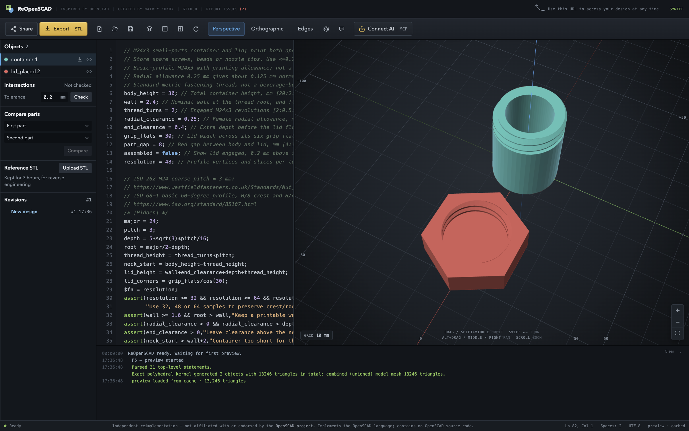

# ReOpenSCAD

As SaaS: [reopenscad.com](https://reopenscad.com)

OpenSCAD in the browser, rebuilt from scratch — a modern web workbench on top
of an independent Rust geometry engine. No OpenSCAD binary, no OpenSCAD
WebAssembly, no OpenSCAD source code: the lexer, parser, evaluator, CSG kernel
and exporters in this repository were all written here.



## What it does

Everything the desktop application does with a `.scad` file, minus the parts a
web app has no business keeping: no menu bar, no tabs, no file name. The
design *is* the document.

The site opens on a landing page: a new-design button, the MCP endpoint to
copy, a public count of designs created (all time and last 24 hours, from
`GET /api/stats`), the designs this browser has opened, and a catalogue of
thirty printable models in eight categories — Gridfinity, IKEA SKÅDIS,
openGrid/Multiboard, threads, DIN rail, maker hardware, hinged boxes and
lettering — each one parametric, each one rendered into its own preview by the
app's own viewer, each opening as a new design. They live in
[`web/examples/`](web/examples/) as real `.scad` files, compiled by the test
suite and checked against the OpenSCAD binary, not as strings in a bundle.

It also does a few things the original does not:

* **Objects panel.** Every top-level solid listed on the left, each one able to
  be hidden on its own.
* **Temporary STL reference.** A design can hold one uploaded STL, for rebuilding
  it as real SCAD. It is deleted 3 hours after upload, and a design still
  importing it stops rendering; remove it to upload another. Agents get the
  workflow from `get_reverse_engineering_guide`.
* **Print orientation in the file.** Each part's bed orientation is a comment
  line OpenSCAD ignores — `// @print <object> rotate=[x, y, z]` or
  `// @print <object> face=-z|+x|...|[nx, ny, nz]` (the outward normal of the
  face that goes down; the part then drops onto z = 0) — so it travels with
  the single file. The objects panel tags oriented parts.
* **Intersection and clearance checking.** Find where parts collide, or where
  they are closer than a fabrication tolerance (0.2 mm by default), and see
  exactly where.
* **Compare parts.** Pick two parts and see where they differ as a heatmap on
  the model.
* **An MCP server.** 46 tools that let an AI agent create a design,
  find its way around a long source (`list_modules` outline, `get_design_code`
  grep and line ranges with long data lines elided), patch it (search/replace
  edits, line ranges, or a parameter block via `set_parameters`), place
  printable lettering with `set_text` (fit to a box, hairlines thickened to a
  minimum stroke, gaps kept open, written as a block later calls replace),
  export, and hand back an editable or
  read-only link. What an agent works on is always what the person sees: every
  change is a saved revision with a name (`revisionName`, at most 40 characters)
  that the open browser renders at once, listed in the Revisions panel and by
  `list_revisions`; `restore_revision` copies an old one on top as a new one, so
  history is never rewritten. A design keeps its last 200 revisions (and at most
  4 MiB of history). Analysis reads the current revision only:
  `evaluate` (with `code` or `edits`, a `revisionName` and `expectedRevision` it
  saves a new revision first; one call, one compile: per-object measurements, every pairwise
  intersection against the tolerance, computed variable values, every
  assert's margin, a verdict separating "compiled" from "printable" with a
  warning for every object that is not a closed solid, optionally a PNG, and
  the diagnostics),
  `render_image` (PNG with named or explicit camera, per-object visibility and
  colours, section plane), `list_design_objects`, `measure` (exact bounds,
  volume, area, components, watertight/manifold/winding, distances, unions of
  objects, opt-in wall-thickness (inscribed-ball estimate that finds oblique
  ligaments, sampled densely only next to creases, refined around each thin
  spot and reported as thin regions with location, minimum and area, plus a
  dense probe at a point), overhang and sharp-edge checks),
  `check_intersections` (exact clearance, overlap volume and where it is,
  intended contact), `check_insertion` (can one
  object travel a translation path past the others: exact swept-volume
  clearance plus conservative advancement to the first contact, so no contact
  is missed; reports the collision point, penetration, minimum clearance and
  the first pose below tolerance), `diff` (what changed
  geometrically between two stored revisions, with a one-line summary and clearance
  before/after) and `get_parameters`. For printing, `set_print_orientation`
  writes a part's `// @print` line (a `describe_geometry` lay-flat candidate,
  a face, or rotate angles) as a revision, `get_print_layout` reports each
  part's size and bed contact once oriented plus an automatic packing on the
  plate (the `plate` argument, or the stored value if there is one, otherwise a
  256 mm bed; plates needed, overflow), and `export_print_parts` returns,
  in one call, a download URL per part (oriented, on z = 0) and per plate
  (3MF). Replies are compact by default
  (`verbose: true` for full records). The analysis tools
  are also HTTP endpoints — per design under
  `/api/designs/{id}/{evaluate,objects,measure,intersections,image,diff,parameters,print-layout}`.
  The design
  export route takes `print=1` (each object in its print orientation on
  z = 0) and `layout=1&sheet=N` (one plate of the layout; `printer=<plate id>`,
  `spacing=<mm>`). The browser
  picks up an agent's edits live and highlights only the lines that changed,
  even when the agent rewrites the whole file.

  Timeouts and retries: a call that runs the evaluator is a job keyed by its
  tool, arguments, the design's current source and assets. An identical call
  while it is queued or running attaches to it instead of queuing again, and
  a successful reply is reused for 3 minutes, so after a client timeout just
  retry the same call. A replayed write (same `expectedRevision`) returns the
  original reply rather than a revision conflict. A job whose callers all
  disconnected keeps running 30 s for a retry to attach
  (`REOPENSCAD_JOB_ORPHAN_GRACE_MS`), then stops and frees its slot.
  `jobs` (`designId`, optional `cancel: <job id>`) lists a design's queued,
  running and recent jobs and cancels one; `notifications/cancelled` naming
  the call's request id withdraws it too. Writes validate by evaluating the
  source without meshing; the object list in a write reply is meshed within
  10 s (`REOPENSCAD_WRITE_OBJECTS_BUDGET_MS`), past which the reply says
  `objectsStatus: "pending"` and `evaluate` does the meshing.
* **Comments on the model, for the agent.** Click a point on the 3D view and
  pin a comment; the agent reads it with `list_feedback` (point, normal,
  object, source line, revision; optionally long-polling for new ones) and
  answers with `resolve_feedback`. When the agent cannot tell which feature
  you mean, `request_pointing` switches the open tab into comment mode with a
  one-line hint ("Show the agent where: the edge that needs a chamfer") and
  returns the pin you place, which answers the request and ends comment mode. Editable links only; read-only links never
  see comments.

Export is STL, 3MF, STEP, OBJ, OFF or GLB, plus a PNG of the view. A
multi-object export keeps every top-level object as its own named, coloured
body in one file rather than unioning them, so a slicer can assign a filament
per part. A single-object export keeps that object's name too (the 3MF
object, the GLB node and material, the STEP solid).

## Running it

```sh
cargo run --manifest-path web/backend/Cargo.toml --release
```

Then open <http://127.0.0.1:5180>. That is the whole setup — the default build
has no dependencies beyond `serde`, and designs go to local JSON files.

For Docker, Postgres-backed storage and Cloud Run, see
[`web/README.md`](web/README.md) and [`web/DEPLOY.md`](web/DEPLOY.md).

## The geometry engine

An exact polyhedral CSG kernel: solids are polygon soups with exact planes,
booleans are computed by BSP classification rather than by sampling a distance
field, and every output edge is the exact intersection of two input planes.
Sharp edges survive exactly, and a swept wall that is not flat — a twisted
extrusion, a revolve — is split rather than fitted to a plane it does not lie
in.

`text()` fills glyph outlines from fonts bundled with the engine — Liberation
Sans, Serif and Mono, plus the Dancing Script and Great Vibes script faces —
rather than from whatever FreeType finds installed, so the same source renders
identically on every machine. `font` takes OpenSCAD's fontconfig syntax;
common system names (Arial, Times, Courier) map to their metric-compatible
Liberation faces, and anything unknown falls back to Liberation Sans with a
warning. `get_supported_scad` lists the bundled faces.

It is held to OpenSCAD's own answers. Three corpora of `.scad` sources are
checked in alongside binary STL goldens that the OpenSCAD binary rendered from
them, and the tests compare what survives a different triangulation — volume,
surface area, watertightness, component count:

| | What it is | Where |
| --- | --- | --- |
| OpenAPPA | Smooth organic geometry the kernel already reproduced | `web/backend/tests/fixtures/openappa/` |
| Hard geometry | Near-tangent unions and sliver faces that used to break it | `web/backend/tests/fixtures/hard-geometry/` |
| Language | Modules and semantics from the language coverage audit | `web/backend/tests/fixtures/language/` |

OpenAPPA and hard geometry come out closed, with volume and surface area matching
to eight or nine significant figures. The hard-geometry fixtures each record the defect they
caught; their [README](web/backend/tests/fixtures/hard-geometry/README.md) is
the best account of how the kernel actually behaves.

```sh
cargo test --manifest-path web/backend/Cargo.toml   # engine and server
npm --prefix web test                               # frontend contracts
```

### ReOpenSCAD extensions

One module exists here and not in OpenSCAD:

```scad
// The volume a part sweeps while moved along a polyline: the union over
// segments of minkowski(child, segment), computed exactly.
sweep_path(points = [[0, 0, 0], [0, -30, 0], [0, -30, -20]]) peg();
```

Use it to model insertion envelopes and keep-out volumes (subtract it from a
housing to cut the channel a part slides through). OpenSCAD itself prints
`WARNING: Ignoring unknown module 'sweep_path'` and draws nothing there, so a
file that uses it renders differently in OpenSCAD; a module of your own named
`sweep_path` shadows the extension. `get_supported_scad` lists it under
`geometry.extensions`.

Language coverage lives in [`SPEC_LANG.md`](SPEC_LANG.md) and the
`web/backend/src/engine/spec_*.rs` tests. The remaining parity gaps are
described in [`web/backend/tests/README.md`](web/backend/tests/README.md).

## Designs

A design is one SCAD file with a funny ID in its URL (`/designs/<id>`), and that
URL is the only credential: anyone holding the link has full read and write.
There are no accounts.

Designs used to be called workspaces. Links and integrations from before the
rename keep working: `/workspaces/<id>` redirects to `/designs/<id>`, every
`/api/designs/...` route is also served at `/api/workspaces/...`, the old MCP
tool names (`create_workspace`, `update_workspace_code`, ...) and the
`workspaceId` argument are accepted as deprecated aliases, and the browser
moves its recents and cached sources to the new storage keys on first load.

**Share** offers two links. The one in the address bar is a capability to
*edit* — there is no login, so handing it over hands over write access. The
read-only link is an independent random token the server maps to the design
in one direction only: a holder cannot derive the editable link from it, which
is what makes it safe to paste where the editable one would not be. A read-only
view can render and export, and can copy the source into a design of its own.

Designs are kept indefinitely — nothing expires on a clock. The one limit is
capacity: a deployment holds a bounded number of them (512 by default; the
Postgres store can be raised with `REOPENSCAD_MAX_WORKSPACES`, the local-file
store is fixed at 512), and when it is full the least recently touched one
goes. On a shared instance that is somebody else's, so keep the
authoritative copy of anything you care about in a local `.scad` file.

Every design this browser has opened is listed on the
landing page, newest first, with a thumbnail of its last render. That list lives in
the browser, not on the server — there are no accounts, so there is nobody to
attribute it to — and removing an entry from it does not touch the design.

## Independence and attribution

ReOpenSCAD is an independent reimplementation and is not affiliated with,
sponsored by, or endorsed by the OpenSCAD project. It implements the OpenSCAD
language and contains no OpenSCAD source code.

OpenSCAD itself is a separate project, licensed GPL-2.0-or-later and copyright
its authors. It lives at <https://openscad.org> and
<https://github.com/openscad/openscad>.

This project's own code is licensed under the **GNU General Public License,
version 3 or later** — see [`LICENSE`](LICENSE). The bundled fonts keep the SIL
Open Font License: see [`web/backend/src/engine/fonts/`](web/backend/src/engine/fonts/).
